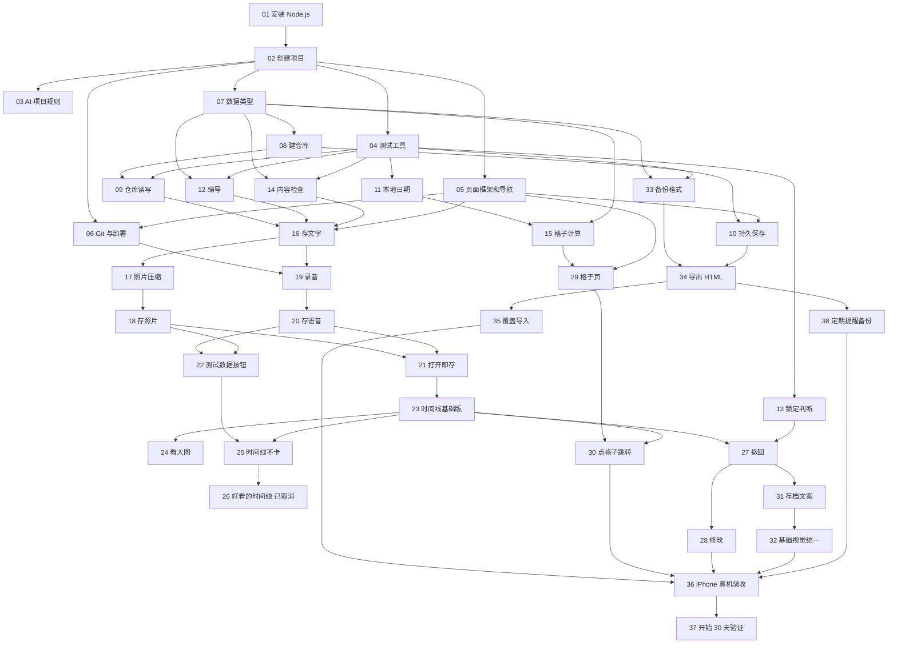

# 此刻存档 · 任务清单（网页验证版）

> 依据：`docs/此刻存档需求文档.md`、`docs/此刻存档技术文档.md`
> 更新日期：2026-10-08

## 怎么使用这份清单

- **按编号顺序做**。每个任务写了“依赖”，依赖里的任务必须先做完。
- 每个任务控制在**一次对话 / 一次提交**能完成。做完一个，按“验收标准”亲手检查一遍，全部通过再提交、再做下一个。
- 验收里出现的几种检查方式：
  - **打开页面看**：在电脑浏览器打开 `http://localhost:5173`（本地开发地址），或在手机打开部署后的 `https://` 网址。
  - **运行测试**：在终端输入 `npm test`，看到全部显示“通过”（绿色的 ✓ / passed）。测试里写好了“输入什么、应该输出什么”，你不用自己算。
  - **看浏览器仓库**：电脑 Chrome 按 `F12`（Mac 是 `Option + Command + I`）打开开发者工具 → 顶部选“Application（应用）” → 左侧“IndexedDB”，能看到存进去的数据。
- 标记为 **（已取消）** 的任务不用做，保留编号只是为了不打乱顺序。
- 文末“待确认”里的事项，要在对应任务开始前定下来。

## 总览

| 阶段 | 任务 | 做完之后你能看到什么 |
| --- | --- | --- |
| 一、准备环境 | 01–06 | 一个空网页，iPhone 能通过正式网址打开 |
| 二、数据仓库 | 07–10 | 浏览器里有了存档仓库 |
| 三、规则计算 | 11–15 | 编号、锁定、内容检查、格子的计算都写好并通过测试 |
| 四、存档 | 16–22 | 能存文字、照片、语音 |
| 五、回看 | 23–26 | 能在时间线上看到所有存档 |
| 六、撤回与修改 | 27–28 | 6 小时内能撤回、能修改 |
| 七、365 格子 | 29–30 | 格子点亮，点了能跳到那天 |
| 八、游戏存档风格 | 31–32 | 文案和视觉有“存档”的感觉 |
| 九、导出与导入 | 33–35、38 | 能备份、能直接打开备份、能覆盖恢复，满 7 天会提醒备份 |
| 十、真机验收与验证 | 36–37 | 在 iPhone 上完整走一遍，然后正式开始 30 天验证 |

## 依赖关系图

箭头表示“前面的做完才能做后面的”。

---

## 一、准备环境

### 01 安装 Node.js

- **依赖**：无
- **要做什么**：在电脑上安装 Node.js（长期支持版，20 或以上）。它是运行和打包网页项目必需的工具。
- **验收标准**：
  1. 打开“终端”，输入 `node -v`，显示 `v20` 或更高的版本号。
  2. 输入 `npm -v`，显示一个版本号（不报错即可）。

### 02 创建项目骨架

- **依赖**：01
- **要做什么**：在项目根目录用 Vite 创建 React + TypeScript 项目，并装好 Tailwind CSS。把首页内容改成只显示一行“此刻存档”。
- **验收标准**：
  1. 终端输入 `npm run dev`，显示一个地址 `http://localhost:5173`。
  2. 用电脑浏览器打开这个地址，页面中间显示“此刻存档”四个字，没有其他默认示例内容（比如 Vite 和 React 的图标）。
  3. 终端输入 `npm run build`，最后没有红色的 error。

### 03 写好给 AI 的项目规则

- **依赖**：02
- **要做什么**：在项目里新建 Cursor 项目规则文件，写明：纯前端项目、数据只存 IndexedDB、不加后端 / 登录 / 云同步、编号不入库、日期统一用本地日期函数。对应技术文档坑 4、坑 5、坑 12。
- **验收标准**：
  1. 项目里存在 `.cursor/rules/` 目录，里面有一个规则文件，内容包含以上 5 条。
  2. 在 Cursor 里新开一个对话，问“这个项目可以加一个登录功能吗？”，AI 的回答会提到这个项目不做登录 / 后端。

### 04 装好自动测试工具

- **依赖**：02
- **要做什么**：装好 Vitest（自动测试工具）和 fake-indexeddb（在测试里模拟浏览器仓库），写一个最简单的示例测试。
- **验收标准**：
  1. 终端输入 `npm test`，看到 1 个测试显示通过（passed），没有失败（failed）。

### 05 页面框架和底部导航

- **依赖**：02
- **要做什么**：做出四个空页面：**存档、时间线、格子、设置**，底部一排按钮可以切换。
- **验收标准**：
  1. 打开首页，默认停在“存档”页，页面标题显示“存档”。
  2. 依次点底部四个按钮，页面标题分别变成“存档”“时间线”“格子”“设置”，当前所在的按钮有高亮。
  3. 在“时间线”页刷新浏览器，仍然停在“时间线”页。
  4. 在电脑浏览器的开发者工具里打开“手机模拟”，选 iPhone 尺寸，底部按钮完整显示、不重叠。（不需要专门适配电脑大屏。）

### 06 上传代码并部署到网上

- **依赖**：02、05
- **要做什么**：用 Cloudflare 官方的部署工具（wrangler），直接从电脑把网页部署到 Cloudflare Pages，不经过 GitHub。加一条命令 `npm run deploy`，以后每次更新网站都运行它。**确定一个正式网址，以后不再更换**（技术文档坑 1）。代码保存在本地 Git 里，暂不推送到网上。
- **验收标准**：
  1. 拿到一个 `https://` 开头的网址，并记录到本文件末尾“正式网址”一栏。
  2. 用 iPhone 的 Safari 打开这个网址，能看到第 05 步做的四个页面，底部导航能切换。
  3. 在电脑上随便改一个文字（比如标题加个感叹号），运行 `npm run deploy`，完成后手机刷新能看到变化。
  4. 在 iPhone 上停在“时间线”页时刷新，仍然停在“时间线”页（不出现 404 错误页）。

---

## 二、数据仓库

### 07 定义数据类型

- **依赖**：02
- **要做什么**：用 TypeScript 写出“存档”和“素材”两种数据的样子，字段与技术文档 3.1 一致（`id`、`createdAt`、`updatedAt`、`text`、`photoIds`、`audioId`；`id`、`saveId`、`kind`、`blob`、`thumbBlob`、`mimeType`、`durationMs`）。同时把规则常量写在一处：文字 200 字、照片 10 张、语音 60 秒、可修改 6 小时。
- **验收标准**：
  1. 打开类型文件，能逐个对上技术文档 3.1 里的字段名。
  2. 规则常量集中在一个文件里，能看到 200、10、60、6 这四个数字。
  3. 终端输入 `npx tsc --noEmit`，没有报错。

### 08 建立浏览器仓库

- **依赖**：07
- **要做什么**：用 Dexie.js 建一个名为 `cike` 的仓库，里面三张表：`saves`、`media`、`settings`，版本号为 1（技术文档 3.1）。
- **验收标准**：
  1. 打开本地网页，进入开发者工具 → Application → IndexedDB，能看到 `cike`，展开有 `saves`、`media`、`settings` 三张表（都是空的）。

### 09 仓库的增、查、改、删

- **依赖**：04、08
- **要做什么**：写好四个操作：新增一条存档（连同照片、语音）、读取全部存档、修改一条存档、删除一条存档（**连同它的照片和语音一起删**）。
- **验收标准**（`npm test` 全部通过，测试需包含以下情况）：
  1. 新增一条“文字 = 你好”的存档后，读取全部存档，得到 1 条，文字是“你好”。
  2. 新增一条带 2 张照片的存档后，`media` 表里有 2 条记录。
  3. 删除这条存档后，`saves` 和 `media` 表里都找不到它和它的照片。
  4. 修改文字为“再见”后，再读取，文字是“再见”，`updatedAt` 比原来大，`createdAt` 不变。

### 10 申请“持久保存”

- **依赖**：05、08
- **要做什么**：打开网页时向浏览器申请“持久保存”，降低数据被系统清理的风险（技术文档坑 2）。在设置页显示结果。
- **验收标准**：
  1. 打开设置页，能看到一行“持久保存：已开启”或“持久保存：未开启”。
  2. 电脑 Chrome 上通常显示“已开启”；iPhone 上“添加到主屏幕”后打开，记录显示结果（无论哪种都算通过，只要能显示）。

---

## 三、规则计算（不碰页面，全部用测试验证）

### 11 本地日期函数

- **依赖**：04
- **要做什么**：写一个函数，输入一个时间，输出这台设备所在地的日期，格式 `YYYY-MM-DD`。以后所有“这是哪一天”都只用它（技术文档坑 5）。
- **验收标准**（`npm test` 通过，测试按北京时间运行）：
  1. 输入北京时间 2026-10-08 07:30 → 输出 `2026-10-08`（**不能**是 `2026-10-07`）。
  2. 输入北京时间 2026-10-08 23:59 → 输出 `2026-10-08`。
  3. 输入北京时间 2026-10-09 00:00 → 输出 `2026-10-09`。

### 12 存档编号计算

- **依赖**：04、07
- **要做什么**：写一个函数，输入全部存档，按保存时间排序，输出每条存档的编号（#1、#2……）。编号**不存进仓库**（技术文档坑 4）。
- **验收标准**（`npm test` 通过）：
  1. 三条存档 A（10:00）、B（11:00）、C（12:00），不论输入时顺序如何 → A=#1、B=#2、C=#3。
  2. 去掉 B 后再算 → A=#1、C=#2。
  3. 再加一条 D（13:00）→ A=#1、C=#2、D=#3。
  4. 没有存档 → 输出为空，不报错。

### 13 锁定判断

- **依赖**：04
- **要做什么**：写一个函数，输入“保存时间”和“现在时间”，判断这条存档是否已锁定（满 6 小时即锁定，恰好 6 小时整也算锁定）。
- **验收标准**（`npm test` 通过）：
  1. 保存后 5 小时 59 分 → 未锁定。
  2. 保存后 6 小时 0 分 1 秒 → 已锁定。
  3. 恰好 6 小时 0 分 0 秒 → 已锁定。

### 14 存档内容检查

- **依赖**：04、07
- **要做什么**：写一个函数，保存前检查内容是否合规，不合规时返回中文原因。
- **验收标准**（`npm test` 通过）：
  1. 文字、照片、语音都没有 → 不通过，原因“至少需要一项内容”。
  2. 只有空格 → 不通过，原因同上。
  3. 文字 200 字 → 通过；201 字 → 不通过，原因“文字最多 200 字”。
  4. 照片 10 张 → 通过；11 张 → 不通过，原因“照片最多 10 张”。
  5. 语音 60 秒 → 通过；61 秒 → 不通过，原因“语音最长 1 分钟”。
  6. 只有 1 张照片、没有文字和语音 → 通过。

### 15 365 格子计算

- **依赖**：07、11
- **要做什么**：写一个函数，输入全部存档和“今天”，输出：起点日期、格子总数、哪些日期点亮。
- **验收标准**（`npm test` 通过）：
  1. 没有存档 → 没有起点，格子总数 0。
  2. 第一条存档在 2026-10-08，今天是 2026-10-10 → 起点 `2026-10-08`，总数 365。
  3. 10-08 存了 3 条、10-10 存了 1 条 → 点亮 `2026-10-08`、`2026-10-10` 两天，10-09 不亮。
  4. 第一条存档在 400 天前 → 总数 401（满 365 后继续延长）。
  5. 把最早的那条去掉，第二条在 10-10 → 起点变成 `2026-10-10`（起点顺延）。

---

## 四、存档

### 16 存档页：存文字

- **依赖**：05、09、12、14
- **要做什么**：存档页放一个文字框和“保存此刻”按钮，保存一条只有文字的存档。保存成功后提示“已存档 · 存档点 #N”，并自动跳到时间线页。
- **验收标准**：
  1. 输入文字时，下方显示字数，例如“12 / 200”。
  2. 输入到 200 字后无法继续输入（粘贴超长文字也会被截到 200）。
  3. 什么都不输入时点“保存此刻”，提示“至少需要一项内容”，不会保存。
  4. 输入“第一条存档”后点“保存此刻”，提示“已存档 · 存档点 #1”，并自动跳到时间线页（此时时间线页还是空页面，第 23 步才会显示内容）。
  5. 再切回存档页，文字框已经清空。
  6. 开发者工具 → IndexedDB → `saves` 里能看到这条记录。
  7. 刷新页面后，这条记录仍在仓库里。

### 17 照片压缩工具

- **依赖**：16
- **要做什么**：写一个工具，把选中的照片压成长边约 2000 像素的大图，并生成一张长边约 400 像素的缩略图。
- **验收标准**：
  1. 在存档页选一张手机原图（3MB 以上），页面临时显示“原图 X MB → 压缩后 Y KB，缩略图 Z KB”，Y 小于 1000，Z 小于 100。
  2. 选一张竖拍的照片，压缩后方向正确，没有被横过来。
  3. 验收后把这行临时显示去掉。

### 18 存档页：添加照片

- **依赖**：17
- **要做什么**：存档页加“添加照片”按钮，可多选，最多 10 张；选好后显示缩略图预览，每张可单独去掉。
- **验收标准**：
  1. iPhone 上点“添加照片”，弹出“拍照 / 照片图库 / 选取文件”选项。
  2. 一次选 3 张，预览区显示 3 张缩略图；点其中一张的“×”，剩 2 张。
  3. 已有 10 张时，“添加照片”按钮变灰；一次选超过 10 张时，提示“照片最多 10 张”，只保留前 10 张。
  4. 只选照片、不写文字，点“保存此刻”，能成功保存。
  5. IndexedDB 的 `media` 表里，每张照片有一条记录，`kind` 是 `photo`，有 `thumbBlob`。

### 19 录音功能

- **依赖**：06、16
- **要做什么**：做一个录音按钮：点击开始，再点停止，显示计时；到 60 秒自动停止。优先使用 mp4 格式（技术文档坑 9）。
- **验收标准**（在**部署后的 https 网址**上测试，技术文档坑 3）：
  1. 第一次点录音，浏览器弹出“是否允许使用麦克风”。
  2. 允许后开始录音，显示计时 `0:01`、`0:02`……
  3. 录 10 秒后点停止，出现一个播放器，点播放能听到刚才的声音。
  4. 一直不停，到 `1:00` 时自动停止。
  5. 拒绝麦克风权限时，提示“需要麦克风权限才能录音”，页面不崩溃。

### 20 存档页：语音接入存档

- **依赖**：19
- **要做什么**：录好的语音可以一起保存进存档；保存前可以删掉重录。
- **验收标准**：
  1. 只录一段语音，不写文字、不加照片，点“保存此刻”，能成功保存。
  2. 同时写文字 + 加 2 张照片 + 录语音，能一起保存成**一条**存档。
  3. 保存前点“删除语音”，播放器消失，可以重新录。
  4. IndexedDB 的 `media` 表里能看到 `kind` 为 `audio` 的记录，`durationMs` 是录音时长（毫秒）。

### 21 “打开即存”的体验

- **依赖**：18、20
- **要做什么**：检查并优化存档路径，做到打开就能存。
- **验收标准**：
  1. 打开网址（或主屏幕图标），第一屏就是存档页，不需要再点任何地方。
  2. 从打开到存下一句话：除了打字外，只需要点“文字框”和“保存此刻”两下。
  3. 存档按钮在手机一屏内可见，不需要滚动。

### 22 开发用：一键生成测试数据

- **依赖**：18、20
- **要做什么**：在设置页加一个**仅在本地开发时出现**的按钮“生成测试数据”，随机生成过去 400 天里的 300 条存档（带文字和图片），用于后面测试时间线和格子。
- **验收标准**：
  1. 本地 `http://localhost:5173` 的设置页有这个按钮；部署后的 `https://` 网址上**没有**这个按钮。
  2. 点一下后，IndexedDB 的 `saves` 表里多出 300 条记录。
  3. 同一页面再加一个按钮“清空全部数据”（同样仅本地出现），点后两张表都变空。

---

## 五、回看

### 23 时间线：基础版

- **依赖**：21
- **要做什么**：时间线页按时间倒序（最新的在最上面）显示所有存档，按日期分组。每张卡片显示：存档点编号、时间、文字、照片缩略图、语音播放器。
- **验收标准**：
  1. 依次存 3 条（文字“一”“二”“三”），时间线从上到下是“三 #3”“二 #2”“一 #1”。
  2. 同一天的存档在同一个日期标题下，例如“2026 年 10 月 8 日”。
  3. 带照片的卡片显示缩略图，带语音的卡片能直接播放。
  4. 没有任何存档时，显示一句空状态提示（例如“还没有存档”），不是空白页。
  5. 在存档页存一条新的，保存后自动跳到时间线，最上面就是它（不需要刷新）。

### 24 时间线：查看大图

- **依赖**：23
- **要做什么**：点卡片上的缩略图，全屏显示这张照片的大图；一条存档有多张照片时，可以左右切换。
- **验收标准**：
  1. 点一张缩略图，全屏显示清晰的大图。
  2. 一条存档有 3 张照片时，可以左右切换，显示“2 / 3”这样的位置。
  3. 点关闭（或下滑），回到时间线原来的位置。

### 25 时间线：存档多了也不卡

- **依赖**：22、23
- **要做什么**：时间线只用缩略图；滚动到附近才加载图片（技术文档坑 10）。
- **验收标准**：
  1. 本地点“生成测试数据”（300 条），打开时间线，3 秒内显示出第一屏。
  2. 在手机上快速从头滑到尾，不出现长时间白屏或页面崩溃。

### 26 （已取消）好看的时间线

- 验证版的时间线做到第 23–25 步的“清楚、够用”即可，精细设计留给 iOS 版（需求文档第 2 节、7.1）。保留编号是为了不打乱后面的任务序号。

---

## 六、撤回与修改

### 27 6 小时内撤回

- **依赖**：13、23
- **要做什么**：6 小时内的存档卡片上显示“放弃这个存档”按钮；点击后二次确认，确认后整条删除。满 6 小时的不显示按钮，改为显示“存档已封存”。
- **验收标准**：
  1. 刚存的存档卡片上有“放弃这个存档”按钮。
  2. 点“放弃这个存档”，弹出确认框；点“取消”，存档还在。
  3. 存 3 条（#1、#2、#3），撤回 #2 → 时间线只剩两条，原来的 #3 变成 #2。
  4. 再存一条新的 → 它是 #3。
  5. 用测试数据里 6 小时以前的存档检查：卡片上**没有**“放弃这个存档”按钮，显示“存档已封存”。
  6. 撤回后，IndexedDB 的 `media` 表里这条存档的照片和语音也被删除。

### 28 6 小时内修改

- **依赖**：18、20、27
- **要做什么**：6 小时内的存档卡片上显示“编辑存档”按钮，打开后可以改文字、增删 / 替换照片、删除 / 重录语音，规则和新建时一样。
- **验收标准**：
  1. 点“编辑存档”，打开的编辑界面里已经填好原来的文字、照片、语音。
  2. 把文字改掉、删掉 1 张照片、加 2 张新照片，保存后时间线上显示新内容。
  3. 把所有内容都删光后点保存，提示“至少需要一项内容”，不保存。
  4. 修改后这条存档的**编号不变、时间线位置不变**。
  5. 6 小时以前的存档卡片上**没有**“编辑存档”按钮。

---

## 七、365 格子

### 29 格子页

- **依赖**：05、15
- **要做什么**：格子页按第 15 步的计算结果画出格子，有存档的日子点亮，并标出“今天”那一格。
- **验收标准**：
  1. 没有存档时，显示一句空状态提示（例如“存下第一个存档，点亮第一格”），不显示格子。
  2. 今天存一条后，显示 365 个格子，第一格点亮，并有“今天”的标记。
  3. 用测试数据（400 天）检查：格子总数是 401，有存档的日子亮、没有的不亮。
  4. 手机上格子不会挤出屏幕，可以上下滚动看完。

### 30 点格子跳到那一天

- **依赖**：23、29
- **要做什么**：点亮的格子可以点，点后切到时间线并滚动到那一天。
- **验收标准**：
  1. 点一个亮的格子，自动切到时间线页，屏幕最上方是那一天的日期标题。
  2. 点一个不亮的格子，没有反应（不跳转、不报错）。

---

## 八、游戏存档风格

### 31 存档文案统一

- **依赖**：27
- **要做什么**：全站按下面的文案表统一用词。前面任务做的时候已经按这张表命名的，这一步做最后的全站检查。

| 位置 | 文案 |
| --- | --- |
| 存档页的保存按钮 | 保存此刻 |
| 保存成功提示 | 已存档 · 存档点 #N |
| 时间线卡片标题 | 存档点 #N |
| 6 小时内整条删除的按钮 | 放弃这个存档 |
| 6 小时内修改的按钮 | 编辑存档 |
| 满 6 小时后卡片上的状态 | 存档已封存 |
| 导出备份的按钮 | 备份存档 |
| 导入恢复的按钮 | 读取存档 |

- **验收标准**：
  1. 在 iPhone 上逐个页面对照上表，所有按钮和提示都一致。
  2. 页面上找不到“保存成功”“撤回”“修改”“导出”“导入”这类通用说法。

### 32 基础视觉统一（够用即可）

- **依赖**：31
- **要做什么**：全站只用黑白两色，**跟随 iPhone 的深色 / 浅色模式自动切换**：浅色模式白底黑字，深色模式黑底白字。字体用 iPhone 系统默认字体。所有存档卡片样式一致。完整的“游戏存档”视觉风格留给 iOS 版。
- **验收标准**：
  1. iPhone 设为浅色模式，打开网页，是白底黑字。
  2. 到“设置 → 显示与亮度”切到深色模式，回到网页（不用刷新），变成黑底白字。
  3. 两种模式下依次打开四个页面，没有出现黑白以外的颜色（照片除外），也没有“看不清的字”（比如黑底黑字）。
  4. 时间线上带文字、带照片、带语音的卡片，外框和间距一致。

---

## 九、导出与导入

### 33 备份数据格式

- **依赖**：04、07
- **要做什么**：写两个函数：把全部存档打包成备份数据（包含 `app`、`formatVersion: 1`、`exportedAt`、`saves`、`media`）；以及把备份数据解析回来，并检查是否完整。
- **验收标准**（`npm test` 通过）：
  1. 3 条存档（含照片和语音）打包后再解析，得到的内容与原来**完全一致**（文字、时间、照片、语音都一样）。
  2. `app` 不是“此刻存档”的数据 → 解析失败，原因“这不是此刻存档的备份文件”。
  3. `formatVersion` 比当前更大 → 解析失败，原因“备份文件版本过新”。
  4. 某条存档引用的照片在备份里找不到 → 解析失败，原因“备份文件不完整”。

### 34 导出：能直接打开的 HTML 备份

- **依赖**：10、33
- **要做什么**：设置页加“备份存档”按钮，下载一个 `.html` 文件。文件里既有排好版、给人看的存档列表，也藏着给机器读的备份数据（技术文档 2.5）。
- **验收标准**：
  1. 点“备份存档”，下载一个名为 `此刻存档备份-2026-10-08.html` 这样的文件（日期为当天）。
  2. **断开网络**，在电脑上双击这个文件，用浏览器打开后能看到所有存档：编号、时间、文字、照片，语音能播放。
  3. iPhone 上导出时，文件能保存到“文件”App 里。
  4. 设置页显示这次导出的文件大小（例如“约 12.3 MB”）（技术文档坑 8）。

### 35 读取存档（覆盖导入）

- **依赖**：34
- **要做什么**：设置页加“读取存档”按钮，严格按“先读文件 → 检查 → 弹窗确认 → 清空 → 写入”的顺序执行（技术文档 2.6、坑 11）。弹窗里有三个选项：“先导出当前数据”“确认覆盖”“取消”。
- **验收标准**：
  1. 先导出一份备份 A；再新存一条“导出后新增”；然后读取备份 A，点“确认覆盖” → 时间线里**没有**“导出后新增”，其余存档与导出时一致。
  2. 读取时点“取消” → 当前数据不变。
  3. 读取时点“先导出当前数据” → 先下载一份当前备份，然后回到确认弹窗。
  4. 选一个随便的网页文件或图片 → 提示“这不是此刻存档的备份文件”，**弹窗不出现，当前数据不变**。
  5. 读取成功后，格子和编号都按备份里的数据重新显示正确。

---

### 38 定期提醒备份存档

> 编号排在最后，是为了不打乱前面的序号；实际在 35 之后、36 之前做。

- **依赖**：34
- **要做什么**：每次成功“备份存档”时记下备份时间。打开网页时，如果距离上次备份已满 7 天，弹窗提醒，有两个选项：“现在备份”“稍后”。还没定的细节见“待确认 2、3”，开始前先定下来。
- **验收标准**：
  1. 点“备份存档”后，设置页显示“上次备份：2026-10-08”（当天日期）。
  2. 把上次备份时间改成 8 天前（开发用，本地可在开发者工具里改），刷新网页，弹出备份提醒。
  3. 点“现在备份”，下载备份文件；再刷新，不再弹窗。
  4. 上次备份时间是 6 天前时，刷新网页，不弹窗。
  5. 点“稍后”后的表现符合“待确认 3”的结论。

## 十、真机验收

### 36 iPhone 完整走一遍

- **依赖**：28、30、32、35、38
- **要做什么**：在 iPhone 上用正式网址，按下面的清单完整走一遍，记录不通过的项，再逐个修。
- **验收标准**：
  1. Safari 打开正式网址 → “分享”→“添加到主屏幕”，主屏幕出现图标，点开后没有 Safari 地址栏。
  2. 从主屏幕图标打开，存一条“文字 + 现场拍照 + 语音”的存档，成功。
  3. 时间线能看到它，照片能看大图，语音能播放。
  4. 格子页今天那一格点亮，点它能跳到时间线。
  5. 6 小时内能“编辑存档”和“放弃这个存档”，满 6 小时后显示“存档已封存”。
  6. 点“备份存档”，保存到“文件”App；在电脑上打开这个文件，能看到内容、能播放这段 iPhone 录的语音（技术文档坑 9）。
  7. 设置页“持久保存”的状态已记录下来。

### 37 开始 30 天验证

- **依赖**：36
- **要做什么**：清空调试数据，在 iPhone 主屏幕图标上正式开始使用，按需求文档 2.1 的标准进行验证。期间只修影响使用的问题，不加新功能。
- **验收标准**（验证结束时自己检查）：
  1. 格子页的**前 30 格**里，至少有 **20 格点亮**（从第一次存档那天算起的 30 天里，至少 20 天存了档）。
  2. 期间至少导出过一次备份，并确认备份能在电脑上打开。
  3. 写下 3 句话的验证结论：哪里好用、哪里不好用、是否继续做 iOS 版。

---

## 正式网址

- 正式网址：https://cike-cundang.pages.dev （**确定后不要更换**）
- 更新网站：在项目文件夹运行 `npm run deploy`
- 注意：每次部署时终端还会显示一个带随机前缀的预览网址（如 `https://0449b05d.cike-cundang.pages.dev`），那是另一个仓库，**不要在那里真实使用**（技术文档坑 1）。

## 待确认（需要你决定，不替你脑补）

1. **备份提醒弹窗会打断“打开即存”（任务 38 与任务 21 冲突）**：被触动的瞬间打开网页，如果正好弹出备份提醒，得先处理弹窗才能存档。是接受这个打断，还是改成“存完一条之后再弹”？
2. **从来没备份过时，什么时候开始提醒（任务 38）**：例如从第一次存档那天算起满 7 天？
3. **点“稍后”之后多久再提醒（任务 38）**：下次打开就再提醒，还是隔一天，或者再过 7 天？
