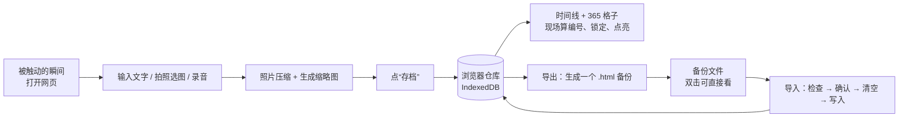

# 此刻存档 · 技术文档（网页验证版）

> 依据：`docs/此刻存档需求文档.md`
> 更新日期：2026-10-08
> 读者：没有编程基础的产品负责人

---

## 0. 先说结论

- **技术方案：React + TypeScript + Vite + Dexie.js**，做成网页后免费部署到 Cloudflare Pages（或 Vercel），在 iPhone 上打开这个网址使用；电脑只用来开发和调试。
- 这个网页是**验证用的 MVP，代码不会复用到 iOS 版**（iOS 版用 SwiftUI 重写）。所以选型以“做得快、改得顺、AI 帮得上忙”为主，不追求长期的完美架构。
- **数据存在浏览器自带的小仓库（IndexedDB）里，不需要服务器、不需要账号。**
- 第 6 节列出的“容易踩坑的地方”都要提前知道，尤其是 **“换网址，存档就全没了”** 和 **“iPhone 上的存档可能被系统清掉”** 这两条。

---

## 1. 先打个比方：这个网页在做什么

把整个产品想成**一本放在你手机里的相册 + 一个存档机**：

- **网页本身**像一台“存档机”的外壳和按钮。它放在网上（某个网址），谁打开都是同一台机器。
- **你的存档**不放在网上，而是放在**你自己 iPhone 的浏览器里的一个小仓库**。网上那台机器只负责“教你的浏览器怎么存、怎么显示”。
- 所以：
  - 不需要服务器存数据，也就没有服务器费用，没人能看到你的存档。
  - 电脑上开发调试时用的是电脑自己的仓库，和 iPhone 上的真实存档互不相通。
  - 仓库一旦被清空，存档就没了，所以“导出备份”非常重要。

---

## 2. 关键功能怎么实现

### 2.1 数据存在哪：浏览器自带的仓库 IndexedDB

| 浏览器里的存储方式 | 打比方 | 能不能用 |
| --- | --- | --- |
| localStorage | 一个只能塞几张便签的小抽屉（约 5MB） | 不行，放不下照片和语音 |
| **IndexedDB** | 一个能放大箱子的储物间（通常可以用到设备剩余空间的相当一部分） | **用这个**，能直接存照片和录音文件 |

IndexedDB 是浏览器自带的，但它原生的用法很啰嗦，所以会配一个“帮手库” **Dexie.js**，让存取数据像“往表格里加一行”一样简单。

### 2.2 照片：拍照或从相册选

- 用网页自带的“选择文件”功能，并限定只能选图片。**在 iPhone 上点它会弹出“拍照 / 照片图库 / 选取文件”**，正好满足“现场拍或从相册选都行”。（电脑上调试时则是选本地图片。）
- **存之前先压缩。** 手机原图一张常常 3～5MB，10 张就是几十 MB。压缩到长边约 2000 像素后，一张通常只有几百 KB，肉眼看差别不大。
- **另外存一张小缩略图**，专门给时间线用。时间线上一屏可能有几十张图，全用大图会很卡。

### 2.3 语音：最长 1 分钟

- 用浏览器自带的录音功能（MediaRecorder）。录到 60 秒自动停止。
- **注意：不同浏览器录出来的文件格式可能不一样**（Safari 偏向 mp4，Chrome 传统上是 webm）。写代码时应优先选择“mp4 格式”，选不了再退回其他格式，这样换浏览器打开备份时更容易播放（见坑 9）。
- **录音必须在 https 开头的网址上才能用**，这是浏览器的安全规定（见坑 3）。

### 2.4 编号、锁定、格子：不存，现场算

需求里这几条规则，最稳妥的做法是**不把结果存进仓库，每次打开时根据存档时间现算**：

| 需要的东西 | 怎么算 | 为什么不存 |
| --- | --- | --- |
| 存档点 #128 的编号 | 把所有存档按保存时间排好，排第几就是 #几 | 撤回后“自动往前补位”就天然成立，不会出现空号或重号 |
| 是否已锁定 | 现在时间 − 保存时间 ≥ 6 小时（恰好 6 小时整也算锁定） | 不用定时去改数据 |
| 格子起点 | 最早那条存档的日期 | 第一条被撤回时，起点自动顺延 |
| 哪些格子亮 | 收集所有存档的日期 | 不会和真实存档对不上 |
| 格子总数 | 从起点到今天的天数，至少 365 | 满 365 天后自然往后延长 |

打个比方：编号就像排队时“你前面有几个人”，而不是贴在你身上的号码牌。有人离队，后面的人自然往前挪。

### 2.5 导出备份：一个能直接打开的网页文件

需求要求“备份文件不依赖本产品也能直接打开查看”，还要“能导回来恢复”。

**做法：导出成一个 `.html` 文件**，里面同时装着两样东西：

1. **给人看的部分**：一页已经排好版的存档列表，文字、照片、语音都直接嵌在里面。双击就能用任何浏览器打开，不需要联网，也不需要这个产品。
2. **给机器读的部分**：同一份数据的“原始版本”，藏在文件里。导入时，产品只读这一部分来恢复。

打个比方：这个文件就像一本**相册，封底夹着一张“原始底片”**。人看相册，机器读底片。

**取舍**：照片和语音都塞进一个文件，文件会比原始素材大约多三分之一。存档多了以后（比如几百条带照片的），文件可能达到几百 MB，打开会变慢，甚至打不开（见坑 8）。到那时可以改成“压缩包（里面一个网页 + 一个素材文件夹）”的方式，但压缩包在 iPhone 上需要先解压才能看，体验差一点。**建议验证期先用单文件，真的变大了再换。**

### 2.6 覆盖导入的安全顺序

覆盖导入是“全部替换”，顺序一定要是：

1. 读取备份文件 → 2. **检查文件完整、格式正确** → 3. 弹窗提示（含“先导出当前数据”）→ 4. 确认后清空当前仓库 → 5. 写入备份数据

**不能先清空再读文件**，否则一旦备份文件是坏的，你会同时失去旧数据和新数据（见坑 11）。

### 2.7 放到网上：免费的静态网站托管

做好的网页是一堆“死文件”（不需要服务器运算），可以免费放在 **Cloudflare Pages** 或 **Vercel** 上：

- 它们会给你一个 `https://` 开头的网址，正好满足录音和拍照的安全要求。
- iPhone 上打开这个网址就能用；电脑也能打开，但只用于调试，不专门适配电脑屏幕。
- iPhone 上建议用 Safari 的“添加到主屏幕”，看起来就像一个 App，而且能降低存档被系统清理的风险（见坑 2）。

---

## 3. 数据结构草图

数据结构就是“仓库里每个箱子贴什么标签、装什么东西”。

### 3.1 仓库里的两张“表”

**表一：存档（saves）**，每条存档一行，只放文字和“素材的取件号”，所以很轻，时间线读起来快。

```text
存档 Save
├─ id          随机生成的唯一身份证号（例如 "a3f9..."），不是 #128，永远不变
├─ createdAt   保存时间（精确到毫秒的时间戳）
├─ updatedAt   最后修改时间
├─ text        文字，最多 200 字；没有文字时为空
├─ photoIds    照片的取件号列表，0～10 个
└─ audioId     语音的取件号；没有语音时为空
```

**表二：素材（media）**，每张照片、每段语音各占一行，真正的“大文件”放在这里。

```text
素材 Media
├─ id          取件号（和上面 photoIds / audioId 对应）
├─ saveId      属于哪条存档
├─ kind        "photo" 或 "audio"
├─ blob        文件本身（压缩后的照片 / 录音）
├─ thumbBlob   照片的小缩略图（仅照片有）
├─ mimeType    文件格式，例如 "image/jpeg"、"audio/mp4"
└─ durationMs  录音时长（仅语音有）
```

为什么分两张表：时间线滚动时只需要先读“存档”表和缩略图，大照片和录音等你点开时再取，就像先看快递单，需要时再去拆箱。

**表三：设置（settings）**，只存少量零碎信息。

```text
设置 Settings
└─ lastBackupAt   上次成功“备份存档”的时间；从没备份过时为空（用于满 7 天提醒）
```

### 3.2 现场算出来的东西（不存进仓库）

```text
编号 #N        = 按 createdAt 排序后的位置 + 1
是否锁定       = 当前时间 - createdAt ≥ 6 小时
格子起点       = 最早一条存档的本地日期
点亮的日期集合 = 所有存档 createdAt 换算成本地日期后去重
格子总数       = max(365, 起点到今天的天数 + 1)
```

### 3.3 备份文件里“给机器读”的部分

```text
{
  "app": "此刻存档",
  "formatVersion": 1,          ← 备份格式的版本号，以后改结构时靠它识别新旧
  "exportedAt": 导出时间,
  "saves": [ ...所有存档... ],
  "media": [ { "id": ..., "mimeType": ..., "data": 文件内容转成的文字 }, ... ]
}
```

---

## 4. 数据是怎么流动的



用大白话说：

1. **存**：你输入内容 → 照片先瘦身 → 点存档 → 放进手机浏览器的仓库。
2. **看**：打开时从仓库取出所有存档 → 现场排队算编号、判断哪些还能改、点亮格子 → 显示时间线。
3. **改 / 撤回**：6 小时内允许改仓库里那一条，或整条删掉；超过 6 小时按钮就不出现。
4. **备份**：把仓库里的东西打包成一个能直接打开的网页文件，存到手机“文件”或电脑里。
5. **恢复**：读备份 → 确认没坏 → 你确认覆盖 → 清空仓库 → 把备份放回去。

---

## 5. 技术方案：React + TypeScript + Vite + Dexie.js

### 5.1 技术选型

| 用什么 | 是什么 | 为什么 |
| --- | --- | --- |
| **React** | 目前最流行的网页界面框架 | 把页面拆成一块块“积木”（存档卡片、格子、录音按钮），每块管好自己；数据一变，画面自动跟着变 |
| **TypeScript** | 带“类型检查”的 JavaScript | 像给每个箱子贴好标签：你往“文字”里塞了照片、或把字段名拼错，写代码时就会被标红提醒 |
| **Vite** | 开发和打包工具 | 改一行代码浏览器立刻刷新；最后把项目打包成可以上网的文件 |
| **Dexie.js** | IndexedDB 的成熟帮手 | 存取仓库像操作表格；支持“仓库结构升级”（见坑 6）；数据一变能让时间线自动刷新 |
| Tailwind CSS（可选） | 写样式的工具 | 调颜色、间距、做“游戏存档”风格比较快 |

**打个比方**：买一套宜家家具。板子、螺丝、说明书都配好了，你按说明拼，想换个抽屉也只动那一块。

### 5.2 架构

```text
页面层（React 积木）
  ├─ 存档页：文字框、拍照选图、录音按钮、“存档”按钮
  ├─ 时间线页：存档卡片列表
  ├─ 格子页：365+ 个格子，点击跳到对应日期
  └─ 设置页：导出 / 导入
        │
规则层（纯计算，不碰画面）
  ├─ 编号计算、6 小时锁定判断、格子日期计算
  └─ 照片压缩、录音、备份文件生成和解析
        │
仓库层（Dexie.js → IndexedDB）
  └─ 存档表 saves、素材表 media
```

分三层的好处：以后想改“6 小时”为“12 小时”，只动规则层的一个数字；想换时间线的样子，只动页面层。

### 5.3 优缺点和取舍

**优点**
- 资料和教程最多，用 AI（包括 Cursor）写代码、修 bug 时效果最好。
- 存档、修改、时间线、格子之间的数据联动多，React 能让“数据一变，画面自动跟着变”。
- 类型检查能提前拦住大量低级错误，对新手很友好。

**缺点**
- 要先安装 Node.js，第一次要理解“安装依赖、启动开发、打包”这几个步骤。
- 项目里文件会多一些，第一眼看上去有点复杂。

**取舍**：用一点点“上手成本”，换来后面功能越加越多时不乱。第一版功能不少（存档、6 小时修改、时间线、格子、导出导入），这个取舍值得。

---

## 6. 以后自己改代码时，特别容易踩的坑

按“出事后果有多严重”从高到低排列。

### 坑 1：换网址，存档就“全没了”（最严重）

浏览器的仓库是**按网址分开的**，而且网址要完全一样才算同一个仓库。

- 本地开发时用的 `http://localhost:5173`，和线上的 `https://xxx.pages.dev`，是**两个不同的仓库**。
- Vercel / Cloudflare 每次预览部署会生成一个新网址，那也是**新仓库**。
- 以后换域名、换托管平台，旧仓库都不会跟过来。

**怎么防**：定下一个正式网址后就别改；自己真实使用只用这一个网址；换网址前一定先导出备份。

### 坑 2：iPhone 上的存档可能被系统自动清掉

Safari 对普通网页的数据有清理机制：**一段时间（约 7 天）没打开过这个网站，它的仓库可能被清空**。另外，“添加到主屏幕”后的网页 App 和 Safari 里打开的网页，**用的也是两个不同的仓库**。

**怎么防**：
- iPhone 上固定用“添加到主屏幕”的方式打开，不要一会儿用 Safari、一会儿用主屏幕图标。
- 代码里向浏览器申请“持久保存”（这是一个标准功能，浏览器不一定答应，但能降低风险）。
- 养成定期导出的习惯。产品里已加入“满 7 天提醒备份”（需求文档 5.7）。注意：上次备份时间也存在同一个仓库里，仓库被清空时它也会一起丢失。

### 坑 3：手机连电脑调试时，录音和拍照用不了

浏览器规定麦克风只能在 `https://` 或 `localhost` 下使用。你在电脑上开发时，用手机访问 `http://192.168.x.x` 这类地址，**录音按钮会没反应**。这不是你代码写错了。

**怎么防**：手机测试统一用部署后的 `https://` 网址；或者在开发工具里开启本地 https（Vite 有现成插件）。

### 坑 4：别把“#128”这个编号存进仓库

如果把编号当作一个字段存起来，撤回时就得手动把后面每一条的编号减 1，一旦漏改或改到一半出错，就会出现重号、空号。

**怎么防**：坚持 2.4 的做法，编号永远现场排队算。存进仓库的只有那个永远不变的随机 `id`。

### 坑 5：日期和时间算错一天

- 存档时间要存“时间戳”（一个绝对时刻），显示和点亮格子时再换算成**你手机所在地的日期**。
- 如果直接用“国际标准时间”切日期，北京时间早上 8 点前存的内容会被算到前一天，格子会亮错。
- 出差跨时区时，同一条存档的日期可能变化，这是正常现象。

**怎么防**：所有“这是哪一天”的计算，都统一走一个专门的函数，别在各处各写各的。

### 坑 6：改数据结构时，旧存档打不开

以后如果想给存档加字段（比如“心情”），或改字段名，**旧仓库里的数据不会自动变成新样子**。直接改代码，可能导致旧存档读不出来甚至报错。

**怎么防**：Dexie 支持“仓库版本号”，每次改结构都把版本号加 1，并写清楚“旧数据怎么转成新数据”。备份文件里也有 `formatVersion`，导入时要能识别旧版备份。**改结构之前，先导出一份备份。**

### 坑 7：“6 小时锁定”靠的是手机时间

锁定判断用的是设备当前时间，把手机时间往回调就能“解锁”。对只给自己用的验证版影响不大，知道就好，不必专门处理。

### 坑 8：备份文件越来越大

照片和录音都塞进一个文件，存档多了以后文件可能很大，手机打开会卡，甚至打不开。

**怎么防**：照片一定要压缩；时不时看一下导出文件有多大。真的大到不好用时，再改成压缩包方式（见 2.5 的取舍）。

### 坑 9：录音在别的浏览器里播放不了

在 Chrome 里录的语音，放到 Safari 里可能无法播放，反之亦然。真实使用只在 iPhone 上，平时不会遇到；但**在电脑上打开 iPhone 导出的备份**，或在电脑上调试录音时，可能撞上。

**怎么防**：录音时优先选 mp4 格式；第一版做完后，把 iPhone 导出的备份在电脑上打开，试听一下语音。

### 坑 10：时间线图片多了会变卡

如果时间线直接显示原图，几百条存档后滚动会明显卡顿，甚至让手机浏览器崩溃。

**怎么防**：时间线只用缩略图；用户点开某条存档时才加载原图。

### 坑 11：覆盖导入时，先清空后读文件

如果先清空仓库，再去读备份文件，一旦备份文件损坏，就会两头落空。

**怎么防**：严格按 2.6 的顺序：先读、先检查，确认无误并经用户同意后才清空。

### 坑 12：让 AI 改代码时，它可能“好心”加个服务器

AI 有时会建议“加个后端 / 数据库 / 登录”。这与需求里“只存本地、不要账号”相冲突，而且会让项目复杂很多。

**怎么防**：每次让 AI 改代码时，提醒它“这是纯前端项目，数据只存 IndexedDB，不要加后端”。也可以把这条写进 Cursor 的项目规则里。

---

## 7. 本文档未覆盖的部分

- **“好看的时间线”和完整视觉风格**：验证版只做到够用，精细设计留到 iOS 版。
- **iOS 正式版的技术方案**：方向已定为用 SwiftUI 原生重写，具体技术文档等网页验证通过后再写。能从网页版带过去的是：需求规则、数据结构（第 3 节）、本文第 2.4 节的计算规则，以及验证中得到的结论。
